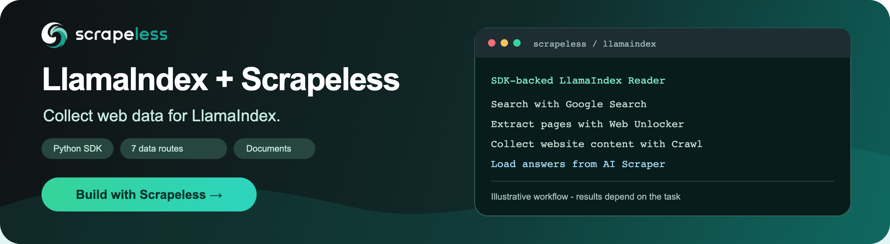

<p align="center">
  <a href="https://app.scrapeless.com/passport/register?utm_source=github&amp;utm_medium=referral&amp;utm_campaign=llamaindex-scrapeless&amp;utm_content=repository-readme"></a>
</p>

# Scrapeless Reader for LlamaIndex

Collect web pages, search results, structured data, and AI answers with the Scrapeless Python SDK, then load them into LlamaIndex as `Document` objects.

**[$5 free credits | No credit card required - Sign up](https://app.scrapeless.com/passport/register?utm_source=github&utm_medium=referral&utm_campaign=llamaindex-scrapeless&utm_content=repository-readme)**

<p align="center">
  <a href="https://app.scrapeless.com/passport/register?utm_source=github&amp;utm_medium=referral&amp;utm_campaign=llamaindex-scrapeless&amp;utm_content=repository-readme"></a>
  <a href="https://www.scrapeless.com/en/blog?utm_source=github&amp;utm_medium=referral&amp;utm_campaign=llamaindex-scrapeless&amp;utm_content=repository-readme"></a>
  <a href="https://x.com/Scrapelessteam?utm_source=github&amp;utm_medium=referral&amp;utm_campaign=llamaindex-scrapeless&amp;utm_content=repository-readme"></a>
  <a href="https://www.linkedin.com/company/scrapeless/?utm_source=github&amp;utm_medium=referral&amp;utm_campaign=llamaindex-scrapeless&amp;utm_content=repository-readme"></a>
</p>

- **Package:** [llamaindex-scrapeless 0.1.1 on PyPI](https://pypi.org/project/llamaindex-scrapeless/0.1.1/)
- **Documentation:** [Python SDK and product inputs](https://docs.scrapeless.com/en/docs/developer-tools/sdks/python-sdk/?utm_source=github&utm_medium=referral&utm_campaign=llamaindex-scrapeless&utm_content=repository-readme)
- **Entry point:** `from llamaindex_scrapeless import ScrapelessReader`

`ScrapelessReader` submits supported requests, waits for completed results, and preserves source metadata for indexing and retrieval.

This repository contains the independently maintained Scrapeless Reader and runnable LlamaIndex examples.

This package is a data Reader. It does not manage datasets, snapshots, object storage, databases, or index persistence. JSON files written by the examples are optional local outputs; applications own their storage and indexing choices.

## Quick start

### Install and configure

Use Python 3.10 or later. Install the package from PyPI:

```bash
python -m pip install llamaindex-scrapeless==0.1.1
```

To develop locally or run repository examples from a source checkout, enter the repository root and run:

```bash
python -m venv .venv
source .venv/bin/activate
python -m pip install -e .
```

The package installs `scrapeless==1.3.0`, `llama-index-core>=0.14.25,<0.15`, Beautiful Soup, and `python-dotenv`. The latter is explicit because SDK 1.3.0 imports it without declaring it.

Get an API key from the [Scrapeless dashboard](https://app.scrapeless.com?utm_source=github&utm_medium=referral&utm_campaign=llamaindex-scrapeless&utm_content=repository-readme) and export it before a live request:

```bash
export SCRAPELESS_API_KEY="YOUR_SCRAPELESS_API_KEY"
```

The SDK reads `SCRAPELESS_API_KEY` and can load `.env`. Keep working credentials private; `.env.example` contains a placeholder only. For explicit configuration, use `ScrapelessReader(api_key=...)`, `sdk_config=...`, or an already configured `client=...`. Do not combine an injected client with `api_key` or `sdk_config`.

### Collect and inspect your first page

Save this as `quickstart.py` in your working directory, then run `python quickstart.py`:

```python
from llamaindex_scrapeless import ScrapelessReader

reader = ScrapelessReader(timeout=120, request_timeout=30)
documents = reader.load_data(
    service="scrape",
    params={
        "url": "https://example.com",
        "options": {"formats": ["markdown"], "onlyMainContent": True},
    },
)

print(f"Documents: {len(documents)}")
for document in documents:
    print("Source:", document.metadata.get("url"))
    print(document.text[:300])
```

For this example, inspect nonempty text explaining the domain's use in documentation examples and a source URL for `example.com`. With `onlyMainContent`, the title `Example Domain` may appear only in `document.metadata["title"]`, rather than in the extracted body. A login or challenge page can contain text without being the requested page. A task ID alone is not collected content. Valid empty results return `[]`; failed tasks and malformed completed results raise errors.

To save Documents and retrieve a passage from the collected page, use the repository source or download the [0.1.1 source distribution](https://pypi.org/project/llamaindex-scrapeless/0.1.1/#files). Run these commands from its root:

```bash
python examples/collect.py --url https://example.com --output outputs/documents.json
python examples/retrieve.py --input outputs/documents.json --query "documentation examples"
```

The saved JSON records `mode="sdk_api"`, text, metadata, and embedding/LLM metadata exclusions. Retrieval returns passage text, source URL, and a ranking score. The example uses local token-count embeddings with a real LlamaIndex `VectorStoreIndex`; no model key is required. A generative application chooses its own embedding model and LLM.

## Supported products and services

One Reader exposes seven routes. `service` selects the SDK API; `params` follows its request schema.

| Product | Reader service | Required inputs in `params` | Document content |
| --- | --- | --- | --- |
| Scraping API | `google_search`, `scraping` | `input` for Google Search; `actor` and `input` for generic scraping | Organic search snippets, or structured JSON/selected records |
| Crawl | `scrape`, `batch_scrape`, `crawl` | `url`, or nonempty `urls` for a batch; optional `options` | Completed pages with source URLs |
| Web Unlocker | `web_unlocker` | `actor`, `input` | Returned JSON content or extracted HTML text |
| AI Scraper | `ai_scraper` | `actor`, `input` | Completed AI answers with available references |

`actor` selects an engine or scraper within its product. A new actor ID does not establish availability or schema compatibility. See the [Python SDK reference](https://docs.scrapeless.com/en/docs/developer-tools/sdks/python-sdk/?utm_source=github&utm_medium=referral&utm_campaign=llamaindex-scrapeless&utm_content=repository-readme) for product inputs.

### Scraping API

The following snippets reuse `reader` from `quickstart.py`. Google Search defaults to actor `scraper.google.search` and maps `organic_results`:

```python
documents = reader.load_data(
    "google_search",
    params={"input": {"q": "retrieval augmented generation", "gl": "us", "hl": "en"}},
)
```

Each Document contains a snippet, title, and link. Fetch the linked page separately for full text. A relative `link` falls back to an absolute `redirect_link` when available. Other verticals need an appropriate `records_selector`.

The generic route accepts actor-specific requests. This function projects records with `description`, `url`, and `id`; select and map fields from the actual actor response:

```python
from llama_index.core import Document


def load_structured_records(actor, actor_input, select_records):
    return reader.load_data(
        "scraping",
        params={"actor": actor, "input": actor_input},
        records_selector=select_records,
        mapping_function=lambda item: Document(
            text=item["description"],
            metadata={"url": item["url"], "record_id": item["id"]},
        ),
    )
```

Optional SDK request fields include `proxy` and `async_`. Remote deferred execution is separate from Python `async/await`; the Reader still waits for completion.

### Crawl

Crawl a bounded set of linked pages:

```python
documents = reader.load_data(
    "crawl",
    params={
        "url": "https://example.com",
        "options": {
            "limit": 3,
            "maxDepth": 1,
            "scrapeOptions": {"formats": ["markdown"], "onlyMainContent": True},
        },
    },
)
```

`limit` is an upper bound, not a promised count. Batch collection uses a URL list:

```python
documents = reader.load_data(
    "batch_scrape",
    params={
        "urls": ["https://example.com", "https://quotes.toscrape.com"],
        "options": {"formats": ["markdown"]},
    },
)
```

Options use SDK dataclass field names, including `maxDepth` and `scrapeOptions`. The adapter validates those fields and omits unset values before using the SDK request layer, avoiding SDK 1.3.0's null-option validation failures. Batch invalid-URL ignoring stays disabled. Pagination is bounded to the same API origin and task; repeated or invalid cursors raise errors.

### Web Unlocker

```python
documents = reader.load_data(
    "web_unlocker",
    params={
        "actor": "unlocker.webunlocker",
        "input": {"url": "https://example.com", "method": "GET", "redirect": False},
    },
)
```

The default mapper extracts text from `html` or `rawHtml`, including HTML strings unwrapped from JSON, and removes script/style content. Inspect the actor's actual response wrapper. SDK 1.3.0 expects JSON at its generic response boundary; direct non-JSON transport is outside the verified path.

### AI Scraper

```python
documents = reader.load_data(
    "ai_scraper",
    params={
        "actor": "scraper.chatgpt",
        "input": {
            "prompt": "Explain retrieval augmented generation and cite sources.",
            "country": "US",
            "web_search": True,
            "shopping": False,
        },
    },
)
```

Inputs follow each engine's schema. The Reader waits for `success` and unwraps `task_result`; its public return type remains `list[Document]`. It recognizes ChatGPT `result_text`, Grok `full_response`, and Alexa `md_text`, and preserves available references. Empty answer text does not cause accompanying ads to be indexed. Collected AI answers are generated content; this Reader does not supply the query engine's LLM.

Representative live checks passed for ChatGPT, Perplexity, Microsoft Copilot, Gemini, Grok, Amazon Alexa, Google AI Overview, and Google AI Mode. Copilot validation covered US/search. See [validation scope](docs/validation.md) for parameter and reliability limits.

## Choose records and metadata

`records_selector(payload)` sees the completed service payload and selects records. `mapping_function(record)` must return a LlamaIndex `Document`. Both callbacks are synchronous. Without them, the mapper extracts common text/Markdown fields, converts HTML to text, or serializes other nonempty structured records as JSON.

Metadata preserves known service, actor, task ID, query/prompt, locale, title, and source URL. Task IDs and reference collections are retained but excluded from embedding and LLM metadata rendering by default. The JSON example preserves those exclusions when saving and reloading Documents. Custom mapping should keep stable IDs, units, currencies, and provenance where meaningful, and exclude credentials.

## Recover tasks and use async

`timeout`, `poll_interval`, and `request_timeout` are seconds at the Reader interface; request timeout is converted to SDK milliseconds. A deadline stops new status checks, while an in-flight request can finish later. Submissions are not automatically retried.

```python
from llamaindex_scrapeless import ScrapelessTaskTimeout

params = {"url": "https://example.com"}
try:
    documents = reader.load_data("crawl", params=params)
except ScrapelessTaskTimeout as error:
    documents = reader.load_data(error.service, task_id=error.task_id, params=params)
```

Retain the task ID privately and resume at an appropriate time. Resuming queries the existing task; local timeout does not cancel it. A status-query failure raises `ScrapelessTaskError` with service, task ID, and the original exception cause. When a known task returns a failed status or unusable data, `ScrapelessReaderError` also retains `service` and `task_id`. Inspect the original task before retrying; an unsuccessful task may not be recoverable. Submission errors and Web Unlocker SDK errors propagate.

`await reader.aload_data(...)` delegates the synchronous SDK to a worker thread. Cancelling the await does not stop that worker or remote task. Use separate configured clients for concurrent calls when SDK state is mutable.

## Run without an API key

```bash
python examples/collect.py --offline --output outputs/offline-documents.json
python examples/retrieve.py --input outputs/offline-documents.json --query "refund window"
```

The fixture contains three synthetic pages and is labeled `offline_fixture`. The query retrieves the refund passage, its `https://example.com/refunds` URL, and the 30-day policy. The lexical score is a ranking value, not an answer-confidence estimate. This verifies collection, serialization, indexing, and retrieval without generating an LLM answer.

The CLI also accepts `--service`, `--params` (JSON file), `--task-id`, and `--key-file` (a private file containing only the raw key). Collected output may be sensitive; choose its storage location accordingly.

## Tourism research Agent example

The optional [tourism research application](examples/tourism_research/README.md) discovers and collects official tourism sources, retrieves evidence through LlamaIndex tools, and exports a cited market brief with its actual tool trace. Install its separate requirements to run the example or its controlled tests.

## Troubleshooting

| Symptom | What to check |
| --- | --- |
| Import fails or the package is missing | Activate the virtual environment and run `python -m pip install -e .` from this repository root |
| `ScrapelessTaskTimeout` | Retain the task ID and resume with the same service and original parameters; do not blindly resubmit |
| Empty content or fewer results than input URLs | Inspect the service result and returned sources; valid empty results can be `[]`, and `limit` is an upper bound |
| Search results do not include full text | `google_search` returns snippets and links; collect the linked pages separately |

## Develop and verify releases

```bash
python -m pip install -e '.[dev]'
pytest --cov=llamaindex_scrapeless --cov-report=term-missing
ruff check .
ruff format --check .
python -m pip check
python scripts/release_checks.py
python -m build
python -m twine check --strict dist/*
python scripts/verify_dist.py --dist dist
```

Start with an empty `dist/`. The Reader suite runs on Python 3.10-3.14 and drives the installed SDK with controlled HTTP responses. It covers dispatch, completion, failures, pagination, cursor safety, timeouts and resumption, mapping, async delegation, offline retrieval, and release gates.

To run the separate [tourism application tests](examples/tourism_research/README.md), install the example requirements first. Those tests exercise partial-repair resumption, concurrent output access, source coverage, and report validation.

GitHub Actions passed the 0.1.1 checks on Python 3.10 through 3.14, including the tourism example and separate installation checks for both distributions. The manual release workflow defaults to `validate`. See [release operations](docs/releasing.md) for future publishing setup and [CHANGELOG](CHANGELOG.md) for version history.

## Scope and limitations

All seven routes have representative successful live checks. The generic Scraping API was tested with the Google Search actor; other actor schemas, large batches/crawls, all markets, and all modes have not been established. One historical batch response already lacked a result at the raw API boundary; later SDK/Reader comparisons returned both pages. Workflows requiring every input URL should compare returned source coverage.

Browser sessions, Profiles, Extensions, Proxies, and click/type/scroll Agent tools are outside this package. See [validation scope](docs/validation.md) for the evidence boundaries.

## License

MIT. See [LICENSE](LICENSE).

## Related projects

| Project | When to use it |
| --- | --- |
| [Scrapeless Python SDK](https://github.com/scrapeless-ai/sdk-python?utm_source=github&utm_medium=referral&utm_campaign=llamaindex-scrapeless&utm_content=repository-readme) | The underlying SDK used by this Reader, or direct calls outside LlamaIndex |
| [Scrapeless MCP Server](https://github.com/scrapeless-ai/scrapeless-mcp-server?utm_source=github&utm_medium=referral&utm_campaign=llamaindex-scrapeless&utm_content=repository-readme) | Connect an MCP-capable tool client; this Reader uses the Python SDK instead |
| [Scrapeless LangChain integration](https://github.com/scrapeless-ai/langchain-scrapeless?utm_source=github&utm_medium=referral&utm_campaign=llamaindex-scrapeless&utm_content=repository-readme) | Use a separately maintained integration in a LangChain application |

## Learn more

- [Python SDK reference](https://docs.scrapeless.com/en/docs/developer-tools/sdks/python-sdk/?utm_source=github&utm_medium=referral&utm_campaign=llamaindex-scrapeless&utm_content=repository-readme)
- [LlamaIndex data connectors](https://developers.llamaindex.ai/python/framework/module_guides/loading/connector/)
- [Scrapeless integrations catalog](https://docs.scrapeless.com/en/integrations/overview/?utm_source=github&utm_medium=referral&utm_campaign=llamaindex-scrapeless&utm_content=repository-readme)

## Contact us

For product or API support, email [support@scrapeless.com](mailto:support@scrapeless.com). Include the version, reproduction steps, and a sanitized error when reporting an integration issue. Do not include API keys or private URLs.
